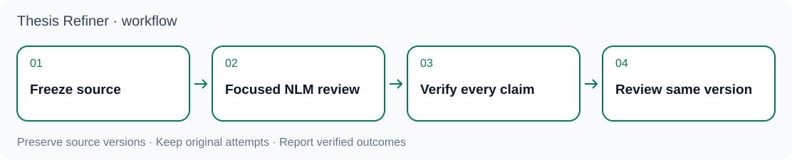

<p align="center"></p>

# Thesis Refiner

**Refine an empirical thesis with traceable evidence, targeted NotebookLM review, and local verification.**

[繁體中文](README.zh-TW.md) · [Agent quickstart](docs/agent-quickstart.md) · [Workflow rules](SKILL.md) · [Maintenance history](docs/MAINTENANCE-NOTES.md)

**Before online review:** NotebookLM requires a Google account and this workflow uploads manuscript sources to Google. Confirm that the material may be uploaded, including any unpublished or restricted research data. You can try the local checks without a Google account. See [Security and data handling](SECURITY.md).

Thesis Refiner gives an AI agent a repeatable workflow for checking claims against data and analysis, revising a manuscript, reviewing a frozen PDF, and assembling a verifiable delivery. The agent does the research and writing; scripts check file identity, evidence contracts, budgets, review records, and delivery consistency. A valid record does not establish that a scientific claim is correct.

<p align="center"></p>

## The review loop

1. **Freeze a candidate.** Identify the Word manuscript, its exported PDF, source files, and hashes. Trace empirical claims to data, variables, sample definitions, model specifications, and outputs. Keep a separate backup of the research originals and work on named copies.
2. **Review by topic.** Bind NotebookLM to the accepted PDF/source and run the agreed review scope: theory and methods, data and figures, structure, language and terminology, citations, and formatting. Keep the original answers and native references.
3. **Verify locally.** Match cited text and structured tables to the frozen document. Distinguish real manuscript problems, model mistakes, correctly retained content, and coverage gaps. Check visual claims against actual rendered pages; text extraction alone cannot prove a layout defect.
4. **Review the same version again.** Formal final acceptance requires two complete rounds on the same frozen PDF/source with independent conversations. Do not count titles, HTTP 200, a completed stream, or a model's claim of full coverage as proof of review. If revision changes the manuscript, bind the new version and invalidate the affected earlier checks.
5. **Deliver the evidence.** Provide the current assets, their fingerprints, issue dispositions, original review records, local decisions, and actual resource-release receipts. Close only what has been verified.

See [the two connected work loops](references/dual-loop-workflow.md), [review and account budgets](references/nlm-review-and-budget.md), and [the delivery contract](references/delivery-contract.md).

## What is included

| Part | Purpose |
| --- | --- |
| [SKILL.md](SKILL.md) and [references](references/) | Task rules for empirical tracing, revision, review, and recovery |
| [scripts](scripts/) and [schemas](schemas/) | Local validation, task checkpoints, account-budget controls, and delivery checks |
| [tests](tests/) | Synthetic offline contract tests, including local loopback TLS probes |
| [adapters](adapters/) and [hooks](hooks/) | Integration material requiring explicit client configuration and validation |
| [CHANGELOG.md](CHANGELOG.md) | Version history and recorded validation boundaries |

## Three complementary projects

| Project | Use it for | When it is needed here |
| --- | --- | --- |
| **Thesis Refiner** | Evidence tracing, manuscript review, and local decisions | Start here for the research workflow and standalone local checks |
| [OfficeCLI Academic Word](https://github.com/lzhs1995/officecli-word-revision) | Document inspection, revision, and supported Word operations | Optional for local review; used for the workflow's Word/Zotero stage after its native tools are validated |
| [Multi-Agent Collaboration](https://github.com/lzhs1995/multi-agent-collaboration) | Agent coordination, handoffs, and shared-resource control | Optional for reading the rules and standalone checks; required by this repository's shared-account NotebookLM runtime |

Each project has its own installation and can serve its own documented tasks. You do not need all three to start offline. Combining them requires compatible versions and actual tool configuration; installing one does not install or activate the others. Statistical execution remains with the appropriate analysis tools. Live NotebookLM work also needs an existing authenticated account and a configured transport. Word and Zotero must be available separately for native operations.

## Try it locally

The commands below pin the reviewed runtime baseline [`c2e14fc`](https://github.com/lzhs1995/thesis-refiner/commit/c2e14fc86aa51a1efa6cee98fc0c802a02850bba). They reproduce that runtime source, **not this new documentation edition or the SDK development candidate**. Keep this guide open separately; the pinned checkout has the earlier README.

For the offline suite, use **Python 3.10+**, **Node.js 18+**, Git, and an isolated Python environment. Dependency installation uses the package index; the tests do not submit NotebookLM queries. Some integration tests require a compatible collaboration checkout and are skipped when it is absent.

```bash
git clone https://github.com/lzhs1995/thesis-refiner.git
cd thesis-refiner
git checkout --detach c2e14fc86aa51a1efa6cee98fc0c802a02850bba
python3 -m venv .venv
. .venv/bin/activate
python -m pip install -r requirements-test.txt
python -B -m unittest discover -s tests -v
```

The complete test command requires a POSIX environment with `fcntl`: installation tests exercise real file locking. Native Windows is not supported by this full suite; changing the virtual-environment activation command does not remove that requirement. These tests also do not establish native Word automation or live NotebookLM transport readiness.

To begin an agent-assisted review, read [the agent quickstart](docs/agent-quickstart.md) and give the agent the absolute path to this checkout's `SKILL.md`. Use a separate private task directory for the manuscript, evidence, and checkpoints. Start with a bounded local inventory before admitting online requests.

## Optional installation

The public installer copies maintained skill files and can create a thin Codex adapter. **It defaults to a dry run.** Choose fresh absolute version directories outside this checkout; the canonical and adapter directories must be separate and must not use symlinked path components. Applying an installation requires POSIX `fcntl` locking, so the installer is not a native Windows installer.

```bash
python -B scripts/install.py --canonical /absolute/releases/thesis-refiner-VERSION/source --codex-adapter /absolute/releases/thesis-refiner-VERSION/adapter
# Inspect the printed plan before applying the same paths.
python -B scripts/install.py --canonical /absolute/releases/thesis-refiner-VERSION/source --codex-adapter /absolute/releases/thesis-refiner-VERSION/adapter --apply
```

Different existing maintained bytes are refused; identical reinstalls are allowed. Keep old tasks on their original source and adapter paths. This installer does not seal a complete repository, switch global discovery aliases, install dependencies, register hooks, restart clients, or migrate a running controller. The maintained-file installer does not copy a complete documentation tree. This new guide and its assets are not present in the pinned older checkout. For an immutable deployment, separately freeze and verify the complete source manifest. See [installation and runtime validation](references/runtime-validation.md).

## Agents and tools

Codex, Claude Code, Gemini CLI, and other agents can read the Markdown instructions and inspect the tools. **Readable rules are not proof that every agent has installed, loaded, or executed the workflow.** The thin [AGENTS.md](AGENTS.md), [CLAUDE.md](CLAUDE.md), and [GEMINI.md](GEMINI.md) files point to shared guidance; client-specific loading, tool availability, authentication, and actual task execution need separate confirmation. No agent receives a live browser, Word session, account, or permission merely by reading this repository.

Preserve each active task's pinned controller and original attempts. An unknown remote result permits bounded reconciliation under the original protocol, not a blind retry or a change of SDK to resend the same request.

## Main and development status

Status recorded on **2026-11-10**:

| Source | Status | What to expect |
| --- | --- | --- |
| [Main runtime baseline](https://github.com/lzhs1995/thesis-refiner/commit/c2e14fc86aa51a1efa6cee98fc0c802a02850bba) | Pinned for the trial above | Existing workflow and local tools; skill version `2026.10.24.1` |
| [Herdr feature branch](https://github.com/lzhs1995/thesis-refiner/tree/feature/nested-chapter-workflow-s40-20261104) | Separate development line | Additional collaboration workflow; not included by checking out the baseline |
| [Draft SDK PR #60](https://github.com/lzhs1995/thesis-refiner/pull/60) | Candidate against the Herdr branch | Optional SDK work; not a released main feature or a verified full CLI/MCP integration |

See [development status](docs/development-status.md) for exact revisions, test observations and remaining limits. Choose a reviewed version explicitly; a branch name or readable document does not switch an active task's tools.

## Development and evidence

Keep real manuscripts, credentials, account identifiers, raw sessions, and machine-specific acceptance records in private task directories. See [SECURITY.md](SECURITY.md) for data handling and vulnerability reporting. Public fixtures are synthetic and confer no manuscript acceptance credit. Run tests appropriate to a change; report skipped cross-repository tests and native checks separately.

The former README is preserved in [Maintenance notes](docs/MAINTENANCE-NOTES.md), with its relative links adjusted for that location. It records historical versions and task-specific observations; it is not an automatic release selector. Use [CHANGELOG.md](CHANGELOG.md), the source you actually checked out, and the current task's pinned evidence together.
