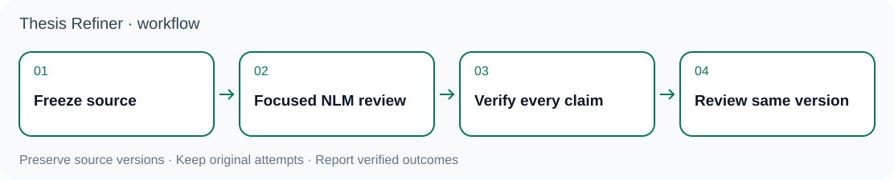

<p align="center"></p>

# Thesis Refiner · 論文精煉助手

**以可追溯的證據、NotebookLM 專題審閱與本地核驗，逐步精煉實證論文。**

[English](README.md) · [Agent 快速上手](docs/agent-quickstart.md) · [工作流程規則](SKILL.md) · [維護歷史](docs/MAINTENANCE-NOTES.md)

**線上審閱前：** NotebookLM 需要 Google 帳號，此流程會將文稿來源上傳至 Google。請先確認材料允許上傳，包括未發表內容或受限制的研究資料。單獨試用本地檢查不需要 Google 帳號。詳見[安全與資料處理](SECURITY.md)。

Thesis Refiner 為 AI agent 提供可重複執行的流程：將論文主張對回資料與分析、修訂文稿、審閱凍結版本的 PDF，最後整理可核驗的交付。研究與寫作由 agent 完成；程式負責檢查檔案身分、證據契約、額度、審閱紀錄及交付一致性。紀錄格式正確，不等於科學結論已經成立。

<p align="center"></p>

## 審閱流程

1. **凍結候選稿。** 明確指定 Word 文稿、匯出的 PDF、來源檔案及雜湊。將實證主張追溯至資料、變數、樣本定義、模型規格與輸出，另外備份研究原件，並在具名副本上操作。
2. **按專題審閱。** 將 NotebookLM 綁定至已核收的 PDF／來源，依約定範圍檢查理論與方法、資料圖表、結構、語言術語、引文及格式六個主題。保存原始回答與原生引用。
3. **在本地核驗。** 將引用文字與結構化表格對回凍結文稿，區分真實文稿問題、模型誤報、經核實而保留的內容，以及覆蓋缺口。視覺問題須查看實際渲染頁面；純文字抽取不能證明版面有缺陷。
4. **對同版稿再複審。** 正式終驗要求在同一凍結 PDF／來源上，以獨立對話完成兩輪完整審查。列出章名、HTTP 200、串流完成或模型自稱讀完整篇，都不能直接證明覆蓋。修訂改變文稿後，須綁定新版本，並使受影響的舊檢查失效。
5. **交付證據。** 提供目前有效資產、檔案指紋、問題處置、原始審閱紀錄、本地裁定與實際資源歸還回執。只關閉已核實的事項。

詳細規則見[兩個交叉推進的工作循環](references/dual-loop-workflow.md)、[審查與帳號額度](references/nlm-review-and-budget.md)及[交付契約](references/delivery-contract.md)。

## 儲存庫內容

| 部分 | 用途 |
| --- | --- |
| [SKILL.md](SKILL.md) 與 [references](references/) | 實證追溯、修訂、審查及恢復的任務規則 |
| [scripts](scripts/) 與 [schemas](schemas/) | 本地驗證、任務檢查點、帳號額度控制及交付檢查 |
| [tests](tests/) | 合成資料的離線契約測試，包含本機迴路 TLS 探測 |
| [adapters](adapters/) 與 [hooks](hooks/) | 需要明確配置與驗證的客戶端整合材料 |
| [CHANGELOG.md](CHANGELOG.md) | 版本歷史及已記錄的驗證邊界 |

## 三個互補專案

| 專案 | 用途 | 在本流程中的需要時機 |
| --- | --- | --- |
| **Thesis Refiner** | 證據追溯、文稿審閱與本地裁定 | 研究流程及獨立本地檢查可從這裡開始 |
| [OfficeCLI Academic Word](https://github.com/lzhs1995/officecli-word-revision) | 文件檢查、修訂及支援的 Word 操作 | 本地審閱可選用；流程進入 Word／Zotero 階段時，須先驗證其原生工具 |
| [Multi-Agent Collaboration](https://github.com/lzhs1995/multi-agent-collaboration) | Agent 協作、交接及共用資源控制 | 閱讀規則與獨立檢查可選用；本倉的共用帳號 NotebookLM 執行器需要它 |

每個專案都有獨立安裝方式，可用於各自文件說明的任務；離線入門不必同時安裝三個專案。組合使用須核相容版本與實際工具配置，安裝其中一個不會自動安裝或啟用另外兩個。統計分析仍由對應工具執行。NotebookLM 線上工作另需既有已認證帳號及設定完成的傳輸入口；原生操作則另需可用的 Word 與 Zotero。

## 本地試用

以下命令固定使用已核對的執行期基線 [`c2e14fc`](https://github.com/lzhs1995/thesis-refiner/commit/c2e14fc86aa51a1efa6cee98fc0c802a02850bba)，重現該版程式碼，**不包含這一輪新文件或 SDK 開發候選**。請另外保留本指南頁面；固定版本中的 README 仍是舊版。

離線測試需要 **Python 3.10+**、**Node.js 18+**、Git 與獨立 Python 環境。安裝相依套件時會使用套件索引；測試本身不提交 NotebookLM 查詢。部分整合測試需要相容的協作儲存庫，缺少時會明確跳過。

```bash
git clone https://github.com/lzhs1995/thesis-refiner.git
cd thesis-refiner
git checkout --detach c2e14fc86aa51a1efa6cee98fc0c802a02850bba
python3 -m venv .venv
. .venv/bin/activate
python -m pip install -r requirements-test.txt
python -B -m unittest discover -s tests -v
```

Windows 使用者可在 PowerShell 執行 `.venv\Scripts\Activate.ps1` 啟用環境。符合測試前置條件，不代表該電腦的原生 Word 自動化或 NotebookLM 線上傳輸已可用。

開始 agent 協助的審閱前，先讀 [Agent 快速上手](docs/agent-quickstart.md)，並把此工作副本的 `SKILL.md` 絕對路徑交給 agent。文稿、證據與檢查點放在獨立私有任務目錄；先完成範圍明確的本地清點，再准入線上請求。

## 選用安裝

公開安裝器會複製受維護的技能檔案，並可建立薄型 Codex 轉接入口。**預設只預覽、不寫入。** 請選擇工作副本以外、全新的絕對版本路徑；技能與轉接目錄須彼此獨立，路徑各層不得使用符號連結。實際安裝需要 POSIX `fcntl` 鎖，因此它不是原生 Windows 安裝器。

```bash
python -B scripts/install.py --canonical /absolute/releases/thesis-refiner-VERSION/source --codex-adapter /absolute/releases/thesis-refiner-VERSION/adapter
# 先核對輸出的計畫，再對相同路徑執行安裝。
python -B scripts/install.py --canonical /absolute/releases/thesis-refiner-VERSION/source --codex-adapter /absolute/releases/thesis-refiner-VERSION/adapter --apply
```

若既有受維護檔案的位元組不同，安裝器會拒絕覆寫；完全相同的重裝則允許。舊任務繼續使用原本的來源與轉接路徑。此安裝器不封存完整儲存庫、不切換全域探索別名、不安裝相依套件、不註冊 hook、不重啟客戶端，也不遷移執行中的控制器。受維護檔案安裝器不複製整個文件目錄；這份新指南與圖像也不在前述固定的舊版工作副本中。若需要不可變部署，須另外凍結完整來源並核對清單。詳見[安裝與執行期核驗](references/runtime-validation.md)。

## Agent 與工具

Codex、Claude Code、Gemini CLI 及其他 agent 都可以讀取 Markdown 指令並檢視工具。**規則可讀，不等於每個 agent 都已安裝、載入或執行流程。** 薄型 [AGENTS.md](AGENTS.md)、[CLAUDE.md](CLAUDE.md) 與 [GEMINI.md](GEMINI.md) 只指向共同規則；客戶端如何載入、工具是否存在、帳號認證與實際任務執行，都須分別確認。讀取儲存庫不會自動取得瀏覽器、Word 工作階段、帳號或操作權限。

保留每個執行中任務綁定的控制器與原次嘗試。遠端結果不明時，只能沿原協議做有界核回，不能盲目重試，也不能改用另一套 SDK 重送同一請求。

## Main 與開發狀態

以下狀態記錄於 **2026-11-10**：

| 來源 | 狀態 | 內容邊界 |
| --- | --- | --- |
| [Main 執行期基線](https://github.com/lzhs1995/thesis-refiner/commit/c2e14fc86aa51a1efa6cee98fc0c802a02850bba) | 上述試用命令已固定 | 既有工作流程與本地工具；技能版本為 `2026.10.24.1` |
| [Herdr feature 分支](https://github.com/lzhs1995/thesis-refiner/tree/feature/nested-chapter-workflow-s40-20261104) | 獨立開發線 | 額外協作流程，不包含在上述基線中 |
| [SDK 草稿 PR #60](https://github.com/lzhs1995/thesis-refiner/pull/60) | 提議合入 Herdr 分支的候選 | 可選 SDK 工作；尚不是 main 已發布功能，也未完成完整 CLI／MCP 整合驗證 |

精確版本、測試觀察及剩餘限制見[開發狀態](docs/development-status.md)。請明確選擇已審閱版本；分支名稱或可讀文件不會切換執行中任務的工具。

## 開發與證據

真實論文、憑證、帳號識別資料、原始工作階段及特定機器的驗收紀錄，應保留在私有任務目錄。資料處理與弱點回報方式見 [SECURITY.md](SECURITY.md)。公開測試資料為合成資料，不計入論文驗收。依修改範圍執行適當測試，將跳過的跨儲存庫測試與原生檢查分開報告。

舊 README 已保留於[維護筆記](docs/MAINTENANCE-NOTES.md)，並調整搬移後的相對連結。該檔記錄歷史版本與特定任務觀察，不能自動用來選擇安裝版本。請一併核對 [CHANGELOG.md](CHANGELOG.md)、實際取得的來源版本，以及目前任務綁定的證據。
